# LzrCnc


**LzrCnc** is a modern, web-based CNC/Laser control server designed for Raspberry Pi (Raspberry Pi OS / Debian), other Linux systems (Debian, Ubuntu, Fedora) and Windows. It recovers the power of LaserWeb4 with a modern React stack, supporting GRBL (Serial) and Klipper (Moonraker) controllers.

> See [CHANGELOG.md](./CHANGELOG.md) for the 2.0 review/upgrade notes.

## Features

-   **Web-Based Control**: Responsive React/Vite UI accessible from any browser.
-   **3D Visualizer (Z-up)**: The XY plane is always the machine bed and +Z always points up/out of it, matching the real machine. 3D / TOP / FRONT / FIT camera presets, color-coded G-code (cut / travel / done) with live job progress.
-   **Laser CAM**:
    -   Import SVG, DXF, PNG/JPG or existing G-code.
    -   Parametric drawing tools that stay editable after placement: rectangle (corner radius), circle by Ø / ellipse, slot, **polygon on a construction circle** (sized by circle Ø or across flats, rotation, centre hole, M2–M12 hex-nut presets; placed by its centre), star, and text (raster image or traced **vector outlines** that can be cut).
    -   Move / rotate / scale objects on the bed or by typing exact mm values.
    -   **Operation profiles** (raster engrave, line engrave, cut) with a name and colour, saved in the browser: tick any number of objects in a profile and change the settings once for all of them; objects show their profile colour; *None* skips an object (guides).
    -   Raster: grayscale / dither / threshold, brightness / contrast / gamma, and a live **burn preview** computed with the same maths as the G-code generator.
    -   Vector cuts run inside-out (holes before the outline that contains them) with nearest-neighbour ordering.
    -   M4 dynamic / M3 constant laser mode, air assist (M8), travel speed, power scaled to GRBL `$30`.
-   **Mill CAM (2.5D)** — *CAM → Mill* tab:
    -   Stock setup (width × depth × thickness, position on the bed, material); **Work Z0 on the stock top or the stock bottom (bed)**.
    -   Per operation, the final depth is given *either* as a depth from the top *or* as the material left above the bottom (never both).
    -   Select closed contours in the 3D view or the list, then stack **Facing**, **Pocket** and **Profile** (on / inside / outside the line) operations.
    -   Tool library (flat / ball / V-bit, Ø, flutes, max RPM) with suggested feeds per material; helical / ramp entry at a set angle (no straight plunges into the material).
    -   Warnings and errors: tool too large for a pocket (the pocket is named and skipped), cut deeper than the stock (into the spoilboard), through-cuts without a skin, stepdown larger than the tool, too-steep ramps or straight plunges, RPM above the tool max, chip load out of range.
    -   Material-removal simulation of the stock (scrubbable), estimated time, then the same Run-job wizard (origin on the stock corner, optional "Set Z0 here", spindle safety checklist).
    -   **Show on machine**: trace the stock outline or the cut area (incl. tool radius) a few mm above the stock, go to the first cut, lift to clearance; the frame is drawn as a green dashed rectangle in 3D.
    -   **Zero, spindle & run** (step 6): set Z0 by hand or with a touch plate, Z-direction test, optional GRBL spindle control (`$32=0/1`, M3 test, M5), then **Run milling job…** opens the wizard directly. The tool library is edited in place from step 3 (the separate *CNC* tab was merged into *Mill*).
    -   *Example* button: 13 mm wood plate 200×200 → 8 mm square part with a 1 mm skin (side A), then flip and face 1 mm (side B) for a perfectly parallel part.
-   **Job control**: Run-job wizard (homing, origin, bounds check, framing, safety confirmation), pause / resume / stop with ETA.
-   **Hardware**: Native GRBL and Klipper support, plus a built-in simulator.
-   **Machine profiles**: save several named machines (laser, mill, laser + mill), simulate any of them without hardware to prepare jobs, export / import them as files or send one straight to another LzrCnc (e.g. the Raspberry Pi).
-   **Macros**: Editable user G-code macros and Klipper macros.
-   **Smart Startup**: Auto-detects port conflicts and recovers from zombie processes.
-   **Update System**: Safe in-place updates preserving user data.

## Screenshots

| Mill CAM | |
|---|---|
|  Stock, operations and toolpaths | 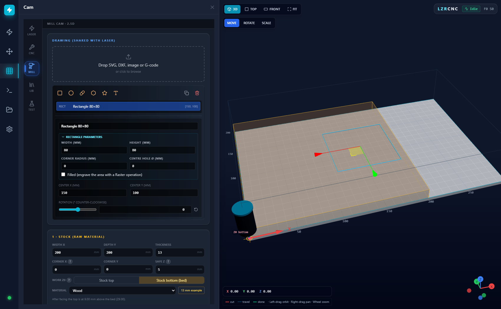 Stock setup, Z0 on top or bottom |
| 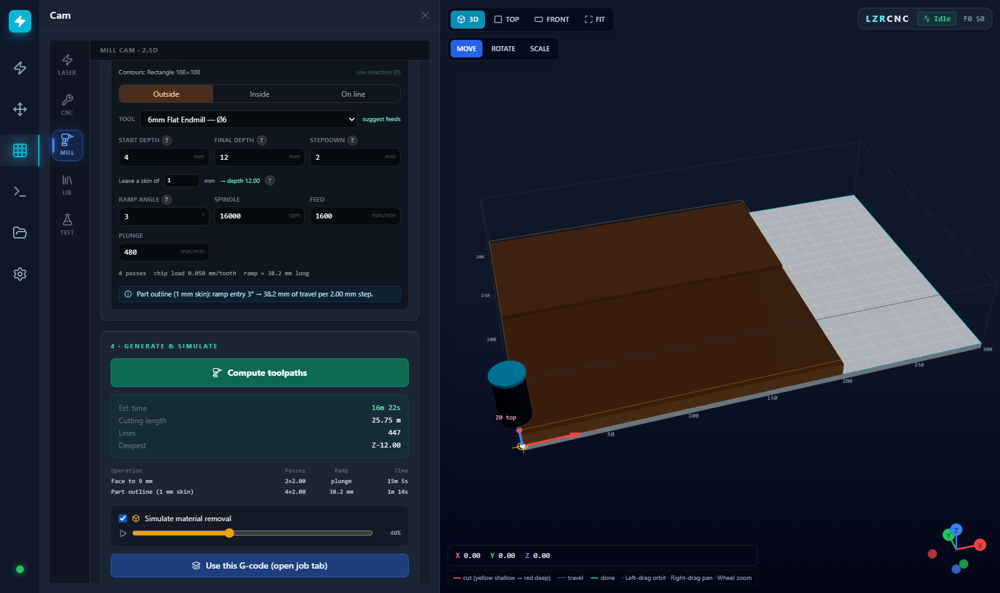 Material-removal simulation | 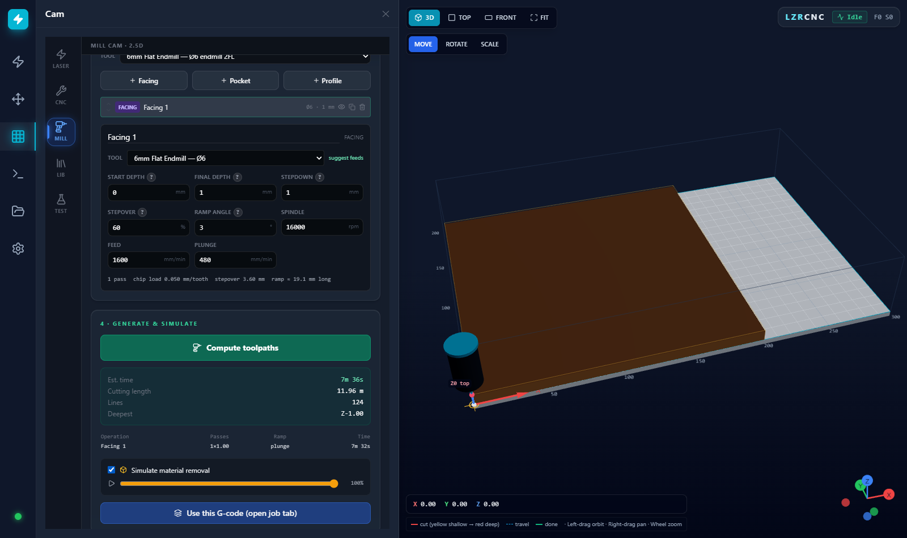 Side B: flip and face 1 mm |
| 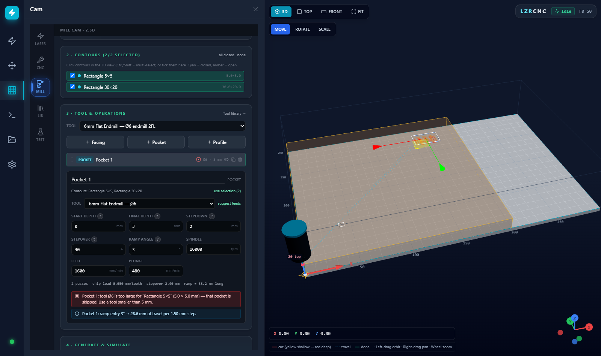 Tool too large for a pocket | 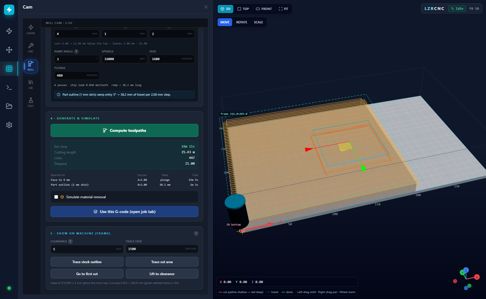 Show on machine (framing) |

| Laser CAM | |
|---|---|
| 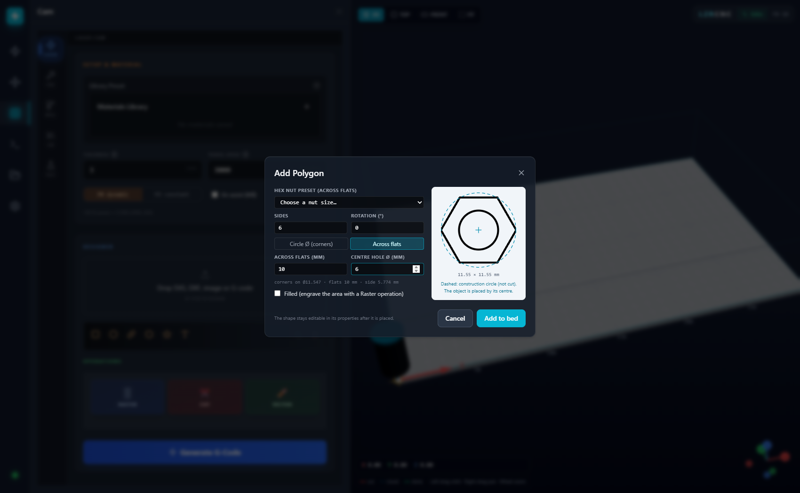 Polygon on a construction circle (M-nut presets) | 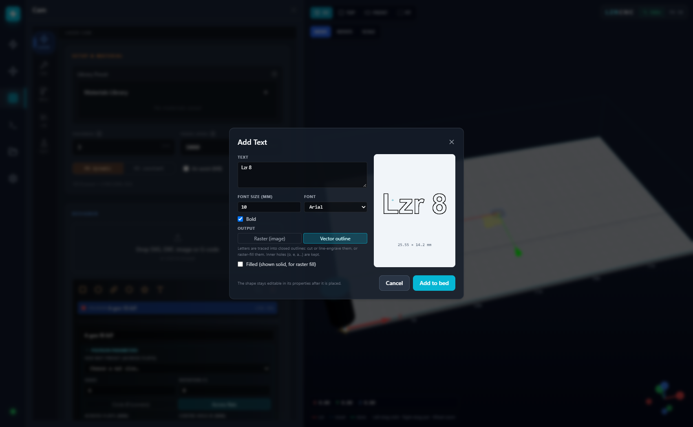 Text as cuttable vector outlines |
| 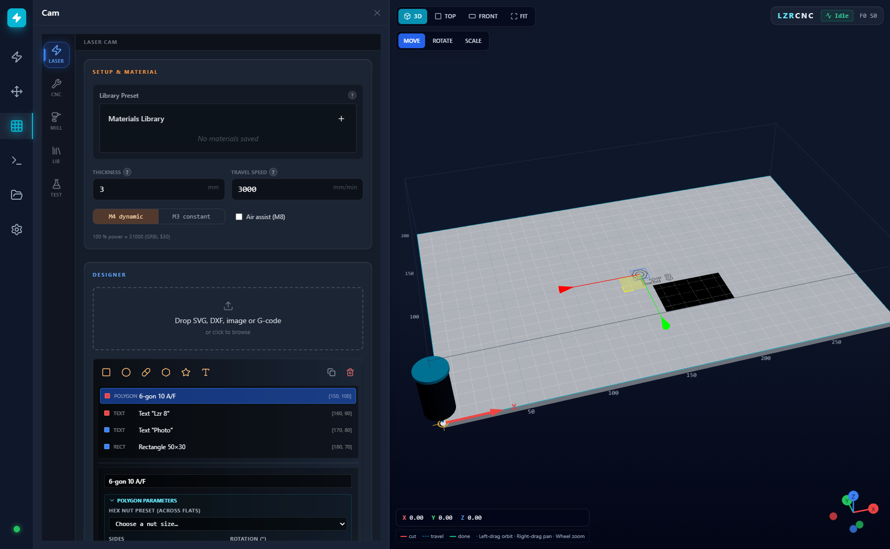 Objects grouped by operation profile | 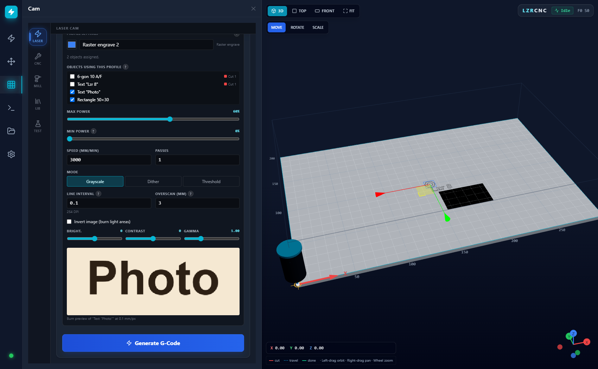 Raster tone curve and burn preview |

| Machines | |
|---|---|
| 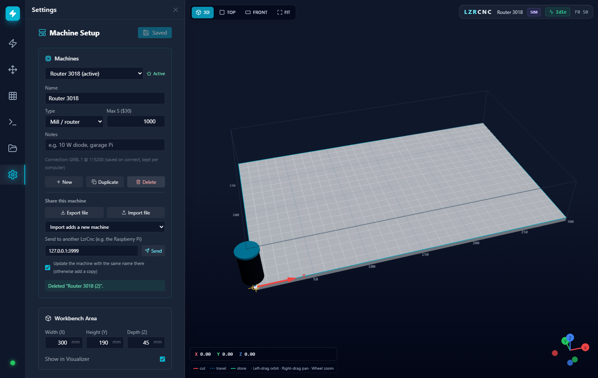 Settings › Machines: name, type, export, send to the Pi | 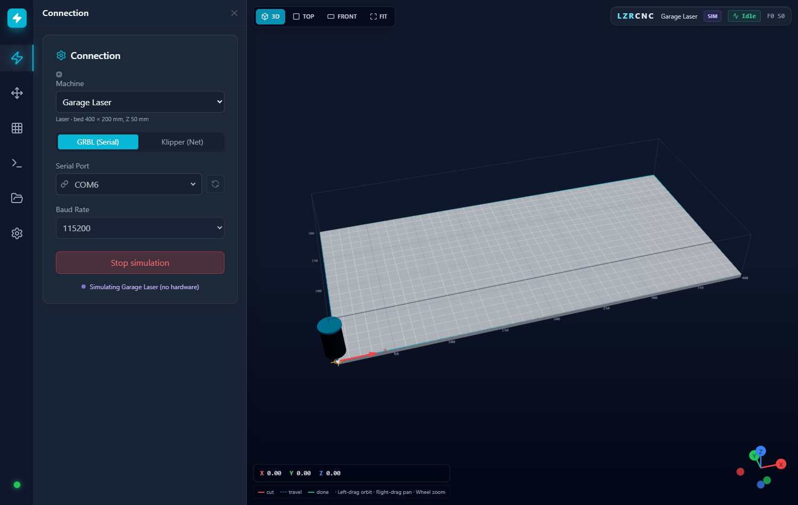 Simulate a saved machine without hardware |

More in [docs/screenshots](docs/screenshots).

## Installation

LzrCnc runs on **Windows 10/11**, **Debian / Ubuntu / Raspberry Pi OS** and **Fedora**. It needs **Node.js 22 LTS** (or 20.19+); the Linux installer installs it for you.
Once started, everything (web UI + API) is served on **one port: `http://<computer>:3001`**.

### Windows
1. Install **Node.js 22 LTS** from <https://nodejs.org/> (default options).
2. Double-click **`install\install.bat`** (no administrator rights needed). It installs the npm packages and builds the web UI.
3. Double-click **`start.bat`**. The browser opens on `http://127.0.0.1:3001` when the server is ready. Close the window (or Ctrl+C) to stop.

```bat
start.bat          :: real machine (GRBL / Klipper)
start.bat sim      :: built-in simulator, no hardware needed
start.bat dev      :: developer mode: hot-reload UI on :3000, API on :3001
start.bat build    :: rebuild the web UI
start.bat stop     :: stop LzrCnc
```
`start.bat` installs missing packages and rebuilds the UI automatically when the sources changed. If an old LzrCnc is still holding the port it is stopped; any other program on the port is never killed (set `LZRCNC_PORT` to use another port).

### Linux: Raspberry Pi OS, Debian, Ubuntu, Fedora
```bash
git clone https://github.com/darkdrago74/LzrCnc.git    # or unzip the download
cd LzrCnc
sudo bash install/install.sh            # asks whether to start at boot
#   sudo bash install/install.sh --service     -> always start at boot (systemd)
#   sudo bash install/install.sh --no-service  -> never ask
```
The installer:
-   installs the system packages with **apt** (Debian / Ubuntu / Raspberry Pi OS) or **dnf** (Fedora): curl, git, compiler, python3...
-   installs **Node.js 22** if it is missing or too old (NodeSource on x64/arm64 Debian, Fedora packages on Fedora, official nodejs.org binaries otherwise, e.g. 32-bit Raspberry Pi OS);
-   runs `npm ci` and builds the web UI **as your normal user** (no root-owned files);
-   adds you to the `dialout` group so the USB serial port (GRBL) works without root (log out / in once);
-   creates the **`lzrcnc`** command, opens port 3001 in firewalld (Fedora), and optionally the `lzrcnc` systemd service.

Then:
```bash
lzrcnc            # start (real machine)  -> http://<pi-ip>:3001
lzrcnc sim        # simulator
lzrcnc dev        # developer mode (:3000 hot reload + :3001 API)
lzrcnc build      # rebuild the web UI
lzrcnc status     # is it running?
lzrcnc stop       # stop a terminal-started LzrCnc
```
With the boot service: `sudo systemctl status|restart|stop lzrcnc`, logs with `journalctl -u lzrcnc -f`. `lzrcnc` tells you when the service is already running instead of starting a second copy.

**Raspberry Pi notes**: a Pi 3 / 4 / 5 or Zero 2 W is required (the Pi Zero / Pi 1 ARMv6 CPU is not supported by Node.js 20+). The **64-bit Raspberry Pi OS** is recommended; the 32-bit OS works with the official Node.js armv7 binaries. The first install takes several minutes; on 1 GB boards enable some swap if the UI build runs out of memory.

> **Not yet verified on Raspberry Pi hardware.** The installer and launchers were tested on Windows, Fedora 44 and Debian 13 (x64). The 32-bit Node.js download path was exercised on Debian x64, not on ARM. Please run `sudo bash install/install.sh`, then `bash install/validate.sh`, on your Pi and report any failure.

**Fedora notes**: tested on Fedora 44 (dnf, Node 22 from the Fedora repositories, firewalld, SELinux enforcing-compatible service using `/usr/bin/node`).

### Manual / developer setup
```bash
cd soft
npm install
npm run dev     # server on :3001, client (Vite) on :3000 - open http://localhost:3000
npm run sim     # same, but with a simulated GRBL machine (no hardware needed)
npm test        # server + client unit tests
npm run build   # production build of both workspaces (with type checking)
```
In development the Vite dev server proxies API calls to the server (`LZR_API_TARGET` overrides the target, default `http://localhost:3001`).

## Usage
### Hardware Connection
**GRBL**:
- Connect your board via USB.
- In **Machine Settings**, select "GRBL Import" to auto-configure your workspace dimensions.
- Use the **Hardware Parameters** tab to fine-tune your machine's speeds, accelerations, and travel limits directly on the EEPROM.
- **Controls**: Homing (`$H`) and Unlock (`$X`) are available in the setup tab.

### Machine profiles
Each LzrCnc keeps a list of named machines (`soft/server/data/machines.json`; an older `machine_settings.json` is imported automatically as "My machine").
The **active** machine sets the bed shown in the visualizer, the CAM limits and the simulator.

-   **Settings → Machines**: pick the machine to edit, rename it, set its type (laser / mill / laser + mill), max S (`$30`) and notes, then **Save**. **New**, **Duplicate**, **Delete**, **Set active**.
-   **Prepare a job offline**: in **Connection**, choose the machine, then **Simulate "name"**. You get a virtual machine with that bed size (jog, framing, run job); no hardware or `npm run sim` needed. CAM works even without connecting.
-   **Connect**: the port / baud (or Klipper host) used is stored in the active machine, so it is filled in next time.
-   **Update the Raspberry Pi from your PC**: edit the machine on the PC, then in **Share this machine** type the Pi address (e.g. `192.168.1.20:3001`) and click **Send**. With "Update the machine with the same name there" it replaces the Pi's profile of that name and keeps the Pi's own serial port; otherwise it adds a copy. Alternatively **Export file** and **Import file** on the other device.
-   The active machine cannot be switched or replaced while real hardware is connected or a job is running (disconnect first). Switching is allowed while simulating.

### Coordinate convention
All machine and CAM coordinates are in millimetres with the origin at the bed's home corner (front-left by default, configurable in **Settings → Axis Configuration**):
+X to the right, +Y towards the back, +Z up (away from the bed). The visualizer always shows XY as the bed plane with Z pointing up; the camera cannot orbit below the bed.

## Maintenance

### Updating LzrCnc
Updates keep your machine settings, tools and materials (`soft/server/data/`).

-   **Web UI**: Machine Settings -> System Updates -> Check for Updates -> Update (Linux git installs). The server pulls, rebuilds and exits; the boot service restarts it automatically, otherwise run `lzrcnc` again.
-   **Linux command line**: `bash install/update.sh` (as your normal user), then restart LzrCnc.
-   **Windows**: replace the files (or `git pull`), then run `start.bat` - it reinstalls packages / rebuilds the UI when needed.

### Uninstallation (Linux)
```bash
sudo bash install/uninstall.sh          # removes service, 'lzrcnc' command, packages and build - keeps your settings
sudo bash install/uninstall.sh --all    # also deletes soft/server/data (asks for confirmation, -y to skip)
```
Node.js and system packages are left installed. On Windows simply delete the folder.

### Checking an installation (Linux)
`sudo bash install/validate.sh` installs, starts `lzrcnc sim`, checks the API and web UI, then stops it (a running service is paused during the test and restarted afterwards).

## Project Structure

-   `start.bat` / `lzrcnc.sh`: launchers for Windows / Linux (`lzrcnc_start.sh` is kept as an alias for old installs).
-   `install/`: `install.bat` (Windows), `install.sh`, `update.sh`, `uninstall.sh`, `validate.sh` (Linux).
-   `soft/server/`: Fastify/Node.js backend (TypeScript run with `tsx`); serves the built UI from `soft/client/dist`.
-   `soft/server/data/`: **user data** (machine settings, tools, materials). Ignored by git, kept on update.
-   `soft/client/`: React/Vite/Three.js frontend.
-   `docs/screenshots/`: screenshots of the Mill and Laser CAM.

## Troubleshooting

-   **"Port 3001 is used by another program"**: another application uses the port. Close it, or start with another port: `LZRCNC_PORT=3005 lzrcnc` (Linux) / `set LZRCNC_PORT=3005` then `start.bat` (Windows).
-   **Serial port "permission denied" (Linux)**: log out and in again after the install (the `dialout` group is applied at login), check with `groups`.
-   **Cannot reach the Pi from another computer**: use `http://<pi-ip>:3001` (shown at start). On Fedora the installer opens the port in firewalld; with another firewall open TCP 3001.
-   **Cannot reach a Windows PC from a phone**: use the `Network :` address printed by `start.bat`, on the same Wi-Fi. If Windows Firewall blocks "Node.js JavaScript Runtime" (Windows Defender Firewall > Allow an app), allow it for Private networks (needs admin rights).
-   **Blank / dark page in the browser**: press Ctrl+F5. If the app still cannot start, the page shows the reason (blocked script, startup error); press F12 > Console for details.
-   **"Edge opened this page in Internet Explorer mode"** (company PCs): an Edge policy sends `localhost` to IE mode, which cannot run the app. Use `http://127.0.0.1:3001` (what `start.bat` opens) or the network address.
-   **`$'\r': command not found` / `syntax error near unexpected token` on Linux**: the `.sh` files were saved with Windows line endings. The repository's `.gitattributes` keeps them LF; if you copied files by hand run `sed -i 's/\r$//' lzrcnc.sh install/*.sh`.
-   **Files owned by root after a manual `sudo npm ...`**: `sudo chown -R $USER:$USER .` in the project folder (the installer does this automatically).